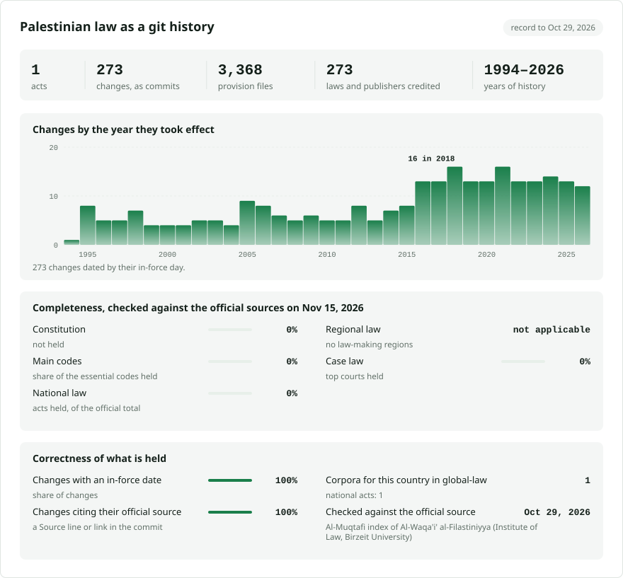

# Palestine: law history in git

[العربية](README.md) · **English**

<picture>
<source media="(prefers-color-scheme: dark)" srcset="data/effort-dark.svg">

</picture>

The law of Palestine as a git history: one file per instrument, Gazette issue and judgment, each committed on the day it took effect (an issue on its publication day, a judgment on the day it was given). `git log` lists what took effect each day; picking a date gives the record as it stood that day.

Part of [lexifina/global-law](https://github.com/lexifina/global-law), one git history for every country's law: this is Palestine's national law, which global-law reads at `palestine/national/acts/`.

**What is in it now:** 1,032 instruments as published in al-Waqa'i' al-Filastiniyya, 1959 to 2026 (42 laws, 307 decree-laws, and decisions, regulations and instructions), 195 full Gazette issues, the Gazette catalogue (3,367 entries, 1994-2026), and 10,216 judgments of eight courts, among them the Court of Cassation (6,519) and the Supreme Constitutional Court (105). The Amended Basic Law and the main codes are not here yet. [`STRUCTURE.md`](STRUCTURE.md) sets out the folders; [`REPRODUCE.md`](REPRODUCE.md) says how the first files were made.

Each entry is `الفهرس/<year>/g<issue>-<item>.md` (`الفهرس/2001/g039-001.md` is قانون العمل رقم (7) لسنة 2000, the Labour Law, listed in issue 39 of 25 November 2001); entries from special issues start `gsp`.

The texts are in Arabic, as the Gazette and the courts published them (through Maqam, An-Najah National University); catalogue titles are as Al-Muqtafi's index prints them, with the field names in English. An English translation is not part of this record.

## Questions as git commands

| Question | Command |
| --- | --- |
| The Labour Law's entry, and the Gazette day that added it | `git log -p -- الفهرس/2001/g039-001.md` |
| Which Gazette day wrote each line of the entry? | `git blame الفهرس/2001/g039-001.md` |
| Every Gazette day in the catalogue, with its date | `git log --format="%h %(trailers:key=In-force,valueonly,separator=) %an" -- الفهرس ":^الفهرس/README.md"` |
| The catalogue as it stood on 1 January 2005 | `python tools/on.py 2005-01-01 الفهرس` |

**Outside git**, we also host this record publicly, for free:

- **[Ask Claude about Palestinian law](https://global-law.lexifina.com/v1/try_claude?country=palestine)**: opens Claude with a first question ready.
- **[Ask ChatGPT](https://global-law.lexifina.com/v1/try_chatgpt?country=palestine)**: the same question in ChatGPT.
- **[Search the Palestinian catalogue on our site](https://lexifina.com/law?country=palestine&q=%D8%A7%D9%84%D8%B9%D9%85%D9%84)**: a search for "العمل" (labour) in its catalogue of titles, no account needed.
- **[Developer REST API](https://global-law.lexifina.com/v1/search_law?query=%D8%A7%D9%84%D8%B9%D9%85%D9%84&jurisdiction=palestine)**: the same search as JSON, with no key. See the [documentation here](https://lexifina.com/api/global-law).

Both assistants read the record through the free Global law connector (MCP, `https://global-law.lexifina.com/mcp`); the first time, the chat gives you the link that adds it. Ask in Arabic or in English.

**Host it yourself easily.** All it takes is git and Python, and the tools run on your machine:

```sh
git clone --depth 1 https://github.com/lexifina/global-law && cd global-law
python3 tools/countries.py add palestine/national/acts
python3 tools/law.py show 2026-01-01 palestine/national/acts/catalogue/g039-001.md
```

Opened in Claude Code, Cursor, VS Code or Codex, the clone also starts a local MCP server with the same tools ([MCP.md](https://github.com/lexifina/global-law/blob/main/MCP.md)).

## Dates

Each commit is dated at noon, Asia/Hebron, on the date of the Gazette issue that lists its entries, and carries it in its `In-force:` trailer:

- the date is read from each issue's label (the index's own date is wrong or missing for some special issues); issues of the same date share one commit, and a text listed in several issues appears once, at the earliest;
- it is not the day the text took effect: a law takes effect 30 days after publication unless it says otherwise (Amended Basic Law 2003, Art. 116), a rule the catalogue does not apply.

No commit is credited to a law: each is credited to the index, as `Catalogue entries of <date>` (`Kind: publisher`). The committer is Lexifina.

## How it is checked

- `tools/catalogue.py` writes the corpus from Al-Muqtafi's issue index, and `tools/build.py` writes the history from it; the same corpus, whose hash is in `data/corpus.sha256`, gives the same commit hashes.
- `tools/check_repo.py` reads every version back from git on its day and on the day before and compares it with the corpus; it also checks that every commit's trailers parse, that `main` has no merge commits and that no commit is dated in the future.
- [`REPRODUCE.md`](REPRODUCE.md) records that the checks were not yet run for this build and that no second build has been compared.
- [vulnerabilities/](vulnerabilities/README.en.md): possible drafting mistakes in this law, found by global-law's detectors and checked by hand. Not run yet.

## What it does not show

- **Law text.** Al-Muqtafi states that its material is copyrighted, and no Palestinian provision exempting laws was found (the 1911 Copyright Act, as applied by the 1924 Ordinance, appears to remain in force), so only facts are copied. An earlier build of the Basic Law's text (2002, 2003 and 2005) is not on `main` for the same reason.
- **Amendments and in-force days.** Each entry is added once and never changed; an amending text is an entry of its own.
- **Full titles that name a person.** 120 entries (appointments, transfers) keep only the type and number.
- **Law from before 1994.** The laws in force before 5 June 1967 were kept in force by Decision No. 1 of 1994 (`الفهرس/1994/g001-002.md`); they were published before this Gazette and are not listed.
- **Case law, treaties and bills.** None.

## Sources

| Source | Kind | Past versions | Notes |
| --- | --- | --- | --- |
| [Al-Muqtafi](http://muqtafi.birzeit.edu/pg/) (Institute of Law, Birzeit University) | Issue index of Al-Waqa'i' al-Filastiniyya, the Official Gazette | no: facts only, one entry per text | Title, type, number, year, issue and date of each text; retrieved 29 October 2026 |

## Licence

See [`LICENSE`](LICENSE). Only facts are copied: no text of any law and no descriptive text of the source. Birzeit University does not endorse this repository. Lexifina's history, commit messages and tools are CC0 1.0.

No AI model wrote or edited any catalogue entry; the scripts were written by an AI model (see [`REPRODUCE.md`](REPRODUCE.md)).

## Visualisations

- [visualisations/](visualisations/README.en.md): charts drawn from this repository. Not drawn yet.

## More

From [lexifina/global-law](https://github.com/lexifina/global-law):

- [FEATURES.md](https://github.com/lexifina/global-law/blob/main/FEATURES.md): every feature, and what every corpus must support (`git blame`, `law.py`, the MCP tools)
- [FAQ.md](https://github.com/lexifina/global-law/blob/main/FAQ.md): questions and answers · [CONTRIBUTING.md](https://github.com/lexifina/global-law/blob/main/CONTRIBUTING.md): proposing changes · [MCP.md](https://github.com/lexifina/global-law/blob/main/MCP.md): the MCP server · [REPRODUCE.md](https://github.com/lexifina/global-law/blob/main/REPRODUCE.md): how it was built · [CHANGELOG.md](https://github.com/lexifina/global-law/blob/main/CHANGELOG.md)
- [FRESHNESS.md](https://github.com/lexifina/global-law/blob/main/FRESHNESS.md): how current each corpus is · [Monitoring](https://github.com/lexifina/global-law/tree/main/monitoring): whether updates are running · [WATCHING.md](https://github.com/lexifina/global-law/blob/main/WATCHING.md): how each official source is watched for changes
- [performance/](https://github.com/lexifina/global-law/tree/main/performance): how fast the tools are, measured
- [visualisations/](https://github.com/lexifina/global-law/tree/main/visualisations): charts and bridges across the world's law
- [Vulnerabilities](https://github.com/lexifina/global-law/tree/main/vulnerabilities): mistakes in legislation as published
