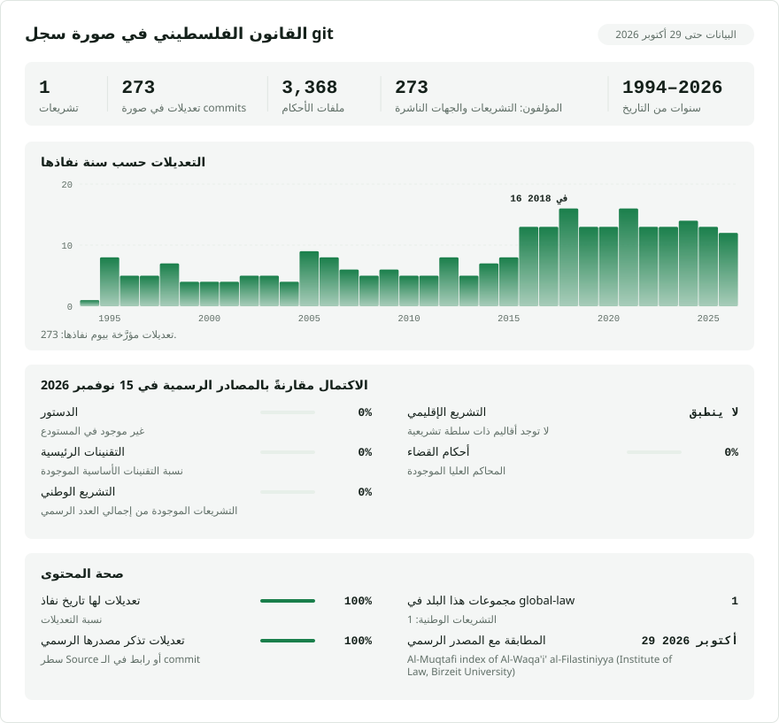

# فلسطين: تاريخ القانون في git

**العربية** · [English](README.en.md)

<picture>
<source media="(prefers-color-scheme: dark)" srcset="data/ar/effort-dark.svg">

</picture>

القانون الفلسطيني في صورة سجل git: ملف واحد لكل تشريع ولكل عدد من الجريدة ولكل حكم، ولكل منها commit في يوم نفاذه (العدد في يوم صدوره، والحكم في يوم النطق به). يسرد `git log` ما نفذ في كل يوم؛ واختيار تاريخ ما يعطي السجل كما كان في ذلك اليوم.

جزء من [lexifina/global-law](https://github.com/lexifina/global-law)، وهو سجل git واحد لقوانين جميع الدول: هذا هو القانون الوطني الفلسطيني، الذي يقرؤه global-law في `palestine/national/acts/`.

**ما يحتويه الآن:** 1,032 تشريعًا كما نُشرت في الوقائع الفلسطينية، من 1959 إلى 2026 (42 قانونًا، و307 قرارات بقانون، وقرارات وأنظمة وتعليمات)، و195 عددًا كاملًا من الجريدة، وفهرس الجريدة (3,367 مدخلًا، 1994-2026)، و10,216 حكمًا لثماني محاكم، منها محكمة النقض (6,519) والمحكمة الدستورية العليا (105). ولا يوجد هنا بعدُ القانون الأساسي المعدَّل ولا القوانين الأساسية الكبرى. يبيّن [`STRUCTURE.md`](STRUCTURE.md) ترتيب المجلدات؛ ويبيّن [`REPRODUCE.md`](REPRODUCE.md) كيف أُعدّت الملفات الأولى.

كل مدخل هو `الفهرس/<year>/g<issue>-<item>.md` (فالملف `الفهرس/2001/g039-001.md` هو قانون العمل رقم (7) لسنة 2000، المدرج في العدد 39 الصادر في 25 نوفمبر 2001)؛ وتبدأ مداخل الأعداد الممتازة بـ `gsp`.

النصوص باللغة العربية، كما نشرتها الجريدة والمحاكم (عن طريق موقع مقام، جامعة النجاح الوطنية)؛ وعناوين الفهرس كما يطبعها فهرس المقتفي، وأسماء الحقول باللغة الإنجليزية. ولا تشكّل الترجمة الإنجليزية جزءًا من هذا السجل.

## الأسئلة بصيغة أوامر git

| السؤال | الأمر |
| --- | --- |
| مدخل قانون العمل، ويوم صدور الجريدة الذي أضافه | `git log -p -- الفهرس/2001/g039-001.md` |
| أي يوم من أيام صدور الجريدة كتب كل سطر من المدخل؟ | `git blame الفهرس/2001/g039-001.md` |
| كل أيام صدور الجريدة في الفهرس، مع تاريخ كل منها | `git log --format="%h %(trailers:key=In-force,valueonly,separator=) %an" -- الفهرس ":^الفهرس/README.md"` |
| الفهرس كما كان في 1 يناير 2005 | `python tools/on.py 2005-01-01 الفهرس` |

**خارج git**، نستضيف هذا السجل أيضًا للعموم مجانًا:

- **[اسأل Claude عن القانون الفلسطيني](https://global-law.lexifina.com/v1/try_claude?country=palestine)**: يفتح Claude مع سؤال أول جاهز.
- **[اسأل ChatGPT](https://global-law.lexifina.com/v1/try_chatgpt?country=palestine)**: السؤال نفسه في ChatGPT.
- **[ابحث في الفهرس الفلسطيني على موقعنا](https://lexifina.com/law?country=palestine&q=%D8%A7%D9%84%D8%B9%D9%85%D9%84)**: بحث عن "العمل" في فهرس العناوين، دون الحاجة إلى حساب.
- **[واجهة REST API للمطورين](https://global-law.lexifina.com/v1/search_law?query=%D8%A7%D9%84%D8%B9%D9%85%D9%84&jurisdiction=palestine)**: البحث نفسه بصيغة JSON، دون مفتاح. انظر [التوثيق هنا](https://lexifina.com/api/global-law).

يقرأ كلا المساعدَين السجلَّ عبر موصل Global law المجاني (MCP، `https://global-law.lexifina.com/mcp`)؛ وفي المرة الأولى تعطيك المحادثة الرابط الذي يضيفه. اسأل بالعربية أو بالإنجليزية.

**استضِفه بنفسك بسهولة.** كل ما يلزم هو git وPython، والأدوات تعمل على جهازك:

```sh
git clone --depth 1 https://github.com/lexifina/global-law && cd global-law
python3 tools/countries.py add palestine/national/acts
python3 tools/law.py show 2026-01-01 palestine/national/acts/catalogue/g039-001.md
```

عند فتح النسخة المستنسخة في Claude Code أو Cursor أو VS Code أو Codex، تشغّل أيضًا خادم MCP محليًا بالأدوات نفسها ([MCP.md](https://github.com/lexifina/global-law/blob/main/MCP.md)).

## التواريخ

يحمل كل commit تاريخ الظهر، بتوقيت Asia/Hebron، من يوم صدور عدد الجريدة الذي يدرج مداخله، ويذكر هذا التاريخ في حقله الختامي (trailer) `In-force:`:

- يُقرأ التاريخ من التسمية التي يحملها كل عدد (فتاريخ الفهرس نفسه خاطئ أو مفقود في بعض الأعداد الممتازة)؛ والأعداد التي تحمل التاريخ نفسه تشترك في commit واحد، والنص المدرج في عدة أعداد يظهر مرة واحدة، في أقدمها؛
- وهو ليس اليوم الذي نفذ فيه النص: فالقانون يُعمل به بعد ثلاثين يومًا من تاريخ نشره ما لم ينص على خلاف ذلك (القانون الأساسي المعدل لسنة 2003، المادة 116)، وهي قاعدة لا يطبقها الفهرس.

لا يُنسب أي commit إلى قانون: بل يُنسب كل منها إلى الفهرس، بعنوان `Catalogue entries of <date>` (`Kind: publisher`). وصاحب الـ commit (committer) هو Lexifina.

## طريقة التحقق

- يكتب `tools/catalogue.py` المجموعة من فهرس أعداد المقتفي، ويكتب `tools/build.py` السجل منها؛ والمجموعة نفسها، التي ترد قيمة تجزئتها في `data/corpus.sha256`، تعطي قيم تجزئة الـ commits نفسها.
- يعيد `tools/check_repo.py` قراءة كل نسخة من git في يومها وفي اليوم السابق له ويقارنها بالمجموعة؛ ويتحقق أيضًا من أن الحقول الختامية لكل commit قابلة للتحليل، وأن `main` لا يحتوي على commits دمج (merge)، وأنه لا يوجد commit مؤرَّخ في المستقبل.
- يسجّل [`REPRODUCE.md`](REPRODUCE.md) أن عمليات التحقق لم تُشغَّل بعد لهذا البناء، وأنه لم تُقارَن به أي عملية بناء ثانية.
- [vulnerabilities/](vulnerabilities/): أخطاء صياغة محتملة في هذا القانون، تكشفها أدوات global-law وتُراجَع يدويًا. لم تُشغَّل بعد.

## ما لا يتضمنه

- **نصوص القوانين.** يذكر المقتفي أن مواده محمية بحقوق التأليف، ولم يُعثر على نص فلسطيني يستثني القوانين (ويبدو أن قانون حقوق الطبع والتأليف لسنة 1911، كما طُبّق بموجب مرسوم سنة 1924، لا يزال نافذًا)، لذلك لا تُنسخ إلا الوقائع. وللسبب نفسه، لا يوجد على `main` بناء سابق لنص القانون الأساسي (2002 و2003 و2005).
- **التعديلات وأيام النفاذ.** يُضاف كل مدخل مرة واحدة ولا يُغيَّر أبدًا؛ والنص المعدِّل مدخل قائم بذاته.
- **العناوين الكاملة التي تذكر اسم شخص.** 120 مدخلًا (تعيينات، تنقلات) لا تحتفظ إلا بالنوع والرقم.
- **القانون السابق لعام 1994.** أبقى القرار رقم (1) لسنة 1994 (`الفهرس/1994/g001-002.md`) القوانين التي كانت سارية قبل 5 يونيو 1967 نافذة؛ وقد نُشرت قبل هذه الجريدة فليست مدرجة فيها.
- **أحكام القضاء والمعاهدات ومشاريع القوانين.** لا شيء منها.

## المصادر

| المصدر | النوع | النسخ السابقة | ملاحظات |
| --- | --- | --- | --- |
| [المقتفي](http://muqtafi.birzeit.edu/pg/) (معهد الحقوق، جامعة بيرزيت) | فهرس أعداد الوقائع الفلسطينية، الجريدة الرسمية | لا: وقائع فقط، مدخل واحد لكل نص | عنوان كل نص ونوعه ورقمه وسنته وعدده وتاريخه؛ استُرجعت في 29 أكتوبر 2026 |

## الترخيص

انظر [`LICENSE`](LICENSE). لا تُنسخ إلا الوقائع: لا نص أي قانون ولا أي نص وصفي من المصدر. ولا تتبنّى جامعة بيرزيت هذا المستودع. أما السجل الذي أعدّته Lexifina ورسائل الـ commits والأدوات فخاضعة لـ CC0 1.0.

لم يكتب أي نموذج ذكاء اصطناعي أي مدخل في الفهرس ولم يحرّره؛ أما البرامج النصية فقد كتبها نموذج ذكاء اصطناعي (انظر [`REPRODUCE.md`](REPRODUCE.md)).

هذا النص ترجمة للنسخة الإنجليزية ([README.en.md](README.en.md))؛ وعند الاختلاف تسود النسخة الإنجليزية.

## الرسوم البيانية

- [visualisations/](visualisations/): رسوم بيانية مستخرجة من هذا المستودع. لم تُرسم بعد.

## المزيد

من مستودع [lexifina/global-law](https://github.com/lexifina/global-law) (صفحات باللغة الإنجليزية):

- [FEATURES.md](https://github.com/lexifina/global-law/blob/main/FEATURES.md): جميع الميزات، وما يجب أن تدعمه كل مجموعة (`git blame`، `law.py`، أدوات MCP)
- [FAQ.md](https://github.com/lexifina/global-law/blob/main/FAQ.md): أسئلة وأجوبة · [CONTRIBUTING.md](https://github.com/lexifina/global-law/blob/main/CONTRIBUTING.md): اقتراح تغييرات · [MCP.md](https://github.com/lexifina/global-law/blob/main/MCP.md): خادم MCP · [REPRODUCE.md](https://github.com/lexifina/global-law/blob/main/REPRODUCE.md): طريقة البناء · [CHANGELOG.md](https://github.com/lexifina/global-law/blob/main/CHANGELOG.md)
- [FRESHNESS.md](https://github.com/lexifina/global-law/blob/main/FRESHNESS.md): مدى حداثة كل مجموعة · [المراقبة](https://github.com/lexifina/global-law/tree/main/monitoring): هل تعمل التحديثات · [WATCHING.md](https://github.com/lexifina/global-law/blob/main/WATCHING.md): كيف يُراقَب كل مصدر رسمي لرصد التغييرات
- [performance/](https://github.com/lexifina/global-law/tree/main/performance): سرعة الأدوات كما قيست
- [visualisations/](https://github.com/lexifina/global-law/tree/main/visualisations): رسوم بيانية وروابط عبر قوانين العالم
- [الثغرات](https://github.com/lexifina/global-law/tree/main/vulnerabilities): أخطاء في التشريعات كما نُشرت
